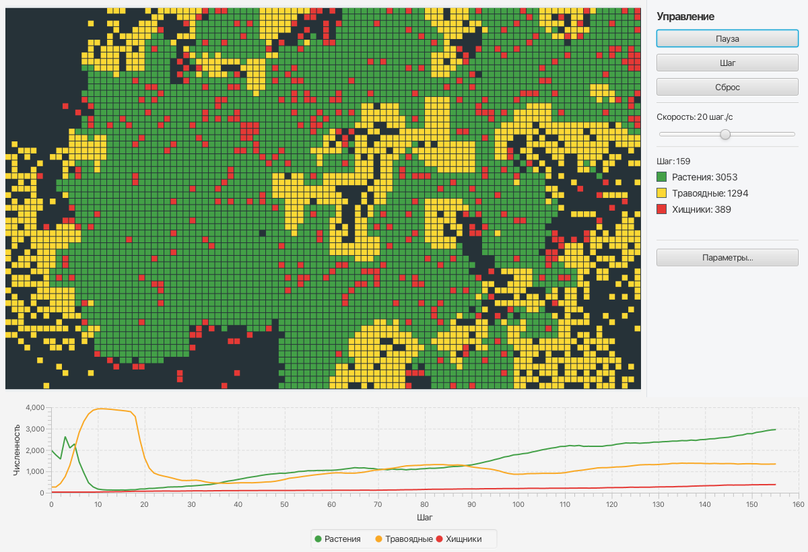
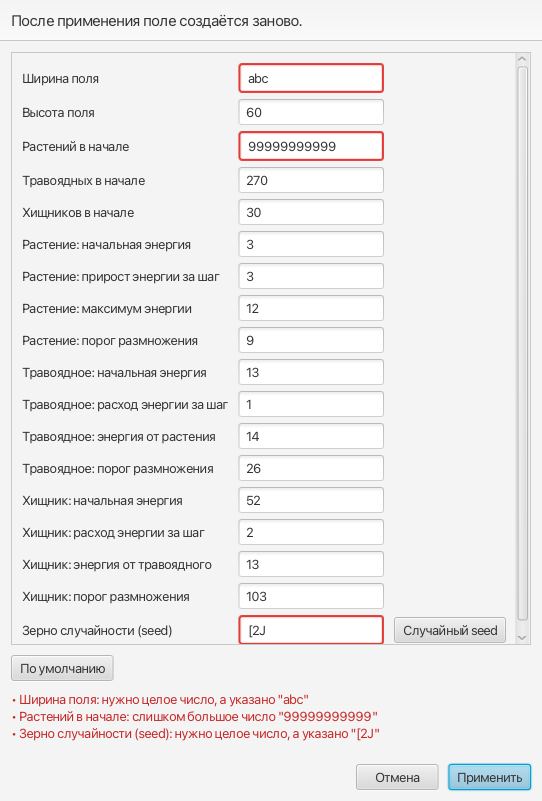

# Искусственная жизнь

Лабораторная работа № 1 по курсу «ООП на языке Java»: программа, использующая логических агентов.

На клеточном поле живут три вида агентов: **растения**, **травоядные** и **хищники**. Они образуют пищевую цепочку:
травоядные едят растения, хищники едят травоядных. У каждого агента есть энергия; когда она кончается, агент погибает,
а при избытке энергии делится. Параметры по умолчанию подобраны так, чтобы жизнь не прекращалась.

Программа есть в двух вариантах: **консольном** (предварительный) и **оконном на JavaFX** (окончательный).



## Требования

- JDK 25
- Maven 3.9+. Отдельно ставить не обязательно: Maven встроен в IntelliJ IDEA.

Библиотеки (JavaFX 25.0.4, JUnit 6.1.3) Maven скачивает сам при первой сборке.

## Запуск

### Из IntelliJ IDEA

1. Откройте папку проекта. Если IntelliJ предложит **Load Maven Project**, согласитесь.
2. Оконная версия: откройте `src/main/java/life/Launcher.java` и нажмите ▶ рядом с `main`.
3. Консольная версия: откройте `src/main/java/life/view/console/ConsoleMain.java` и нажмите ▶ рядом с `main`.
   Команды вводятся в окне вывода внизу.

### Из терминала

```bash
mvn javafx:run
```

Консольная версия:

```bash
mvn compile
java -cp target/classes life.view.console.ConsoleMain
```

Консоли JavaFX не нужен, поэтому её можно запускать обычной командой `java`.

## Управление

### Окно

| Элемент | Что делает |
|---|---|
| **Старт / Пауза** | Запускает и останавливает симуляцию. Повторное нажатие не ускоряет её. |
| **Шаг** | Ставит на паузу и делает ровно один шаг. |
| **Сброс** | Создаёт поле заново с текущими параметрами. |
| **Скорость** | От 1 до 500 шагов в секунду, шкала логарифмическая. |
| **Параметры…** | Все параметры симуляции. При ошибке окно не закрывается, ошибочные поля подсвечиваются. |

Справа показаны номер шага и численность видов, снизу — график численности.
Цвета клеток: растения — зелёные, травоядные — жёлтые, хищники — красные.

### Консоль

| Ввод | Действие |
|---|---|
| Enter | один шаг |
| число `N` | `N` шагов подряд (от 1 до 100000); при долгом выполнении раз в секунду печатается прогресс |
| `h`, `?`, `помощь` | справка |
| `q`, `выход` | выход (также Ctrl+D) |

Поле печатается буквами: `P` — растение, `T` — травоядное, `X` — хищник, `.` — пусто.
На любой другой ввод программа отвечает понятной ошибкой и продолжает работу.

## Правила

- Поле — прямоугольная сетка со стенами; в клетке не больше одного агента.
- За один шаг каждый агент, живой на начало шага, ходит один раз, в случайном порядке.
  Съеденный до своей очереди не ходит, родившийся ждёт следующего шага.
- **Растение** не двигается, каждый шаг получает энергию (не выше максимума).
- **Травоядное** и **хищник** видят квадрат 5×5 вокруг себя и ходят на одну клетку (в том числе по диагонали).
  Каждый шаг они тратят энергию и погибают, когда она доходит до нуля.
- Логика травоядного: ЕСЛИ видит хищника — убегает в самую дальнюю от него клетку;
  ИНАЧЕ ЕСЛИ видит растение — идёт к ближайшему и съедает его; ИНАЧЕ бродит случайно.
- Логика хищника: ЕСЛИ видит травоядное — идёт к ближайшему и съедает его; ИНАЧЕ бродит случайно.
- Размножение: если энергия **больше** порога и рядом есть свободная клетка,
  в ней появляется потомок с половиной энергии родителя.

## Параметры по умолчанию

| Параметр | Растение | Травоядное | Хищник |
|---|---|---|---|
| Количество в начале | 2000 | 270 | 30 |
| Начальная энергия | 3 | 13 | 52 |
| Изменение энергии за шаг | +3 (не выше 12) | −1 | −2 |
| Энергия от еды | — | +14 | +13 |
| Порог размножения | 9 | 26 | 103 |

Поле 100×60, зерно случайности (seed) 42: при одинаковом seed ход симуляции всегда одинаковый.

Параметры подобраны автоматическим перебором. Проверка на 40 seed, которые не участвовали в подборе,
по 10 000 шагов: все три вида выжили во всех 40 прогонах.

## Структура

```
src/main/java/life/
├── Launcher.java            точка входа оконной версии
├── model/                   модель, ничего не знает об интерфейсе
│   ├── Settings             параметры + проверка корректности
│   ├── World, ReadOnlyWorld поле
│   ├── Position             координаты клетки
│   ├── Agent                абстрактный агент: энергия, гибель, деление
│   │   ├── Plant            растение
│   │   └── Animal           абстрактное животное: зрение, ходьба, еда
│   │       ├── Herbivore    травоядное
│   │       └── Predator     хищник
│   ├── Simulation           шаг времени для всех агентов
│   └── Statistics           численность на шаге
├── controller/              логика окна без JavaFX
│   ├── SimulationController старт, пауза, шаг, сброс, скорость
│   ├── SettingsForm         поля окна параметров → Settings
│   └── SpeedScale           слайдер ↔ скорость
├── view/console/            консольная версия
├── view/gui/                оконная версия (JavaFX)
└── util/SafeText            безопасный показ ввода в сообщениях
```

## Тесты

```bash
mvn test
```

417 тестов на JUnit 6, они запускаются в случайном порядке. Тест `BalanceTest` проверяет, что с параметрами
по умолчанию все виды живут 5000 шагов, и длится около 20 секунд; остальные тесты занимают меньше секунды.

## Снимки

| Работа симуляции | Ошибки в параметрах |
|---|---|
|  |  |
